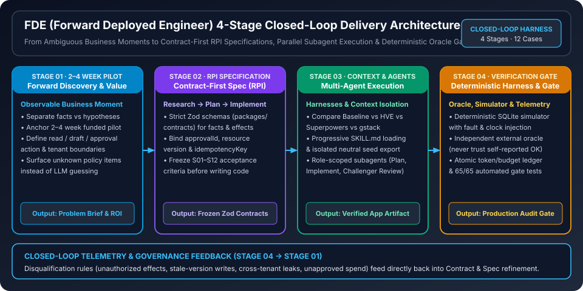

# FDE Engineering Playbook & Neutral Evaluation Harness (`fde-engineering-playbook`)

**Language / 语言**: **[中文 (Chinese)](README.md)** | **[English](README.en.md)** · **Online Interactive Book / 在线交互式实践书**: **[FDE on GitHub Copilot Practice Book](https://turbo998.github.io/FDE-on-GitHub-Copilot-Practice-Book/)**

> **Executive Summary / 核心结论概览**: This repository provides the engineering methodology research, field delivery playbook, and verifiable neutral evaluation harness (TypeScript + Fastify + React + SQLite + Zod) for **Forward Deployed Engineers (FDEs)** building on GitHub Copilot. Key takeaways:
> 1. **4-Stage Closed-Loop Delivery Architecture**: High-leverage FDE delivery connects **Stage 01 Forward Discovery & Value Anchoring (2–4 week funded pilot) → Stage 02 Contract-First RPI Specification (Research → Plan → Implement) → Stage 03 Multi-Agent Parallel Execution & Context Engineering → Stage 04 Deterministic Verification Harness & Production Telemetry Gate**.
> 2. **Orthogonal Separation of Host, Engineering Harness & Business Runtime**: Deconstructs five major AI engineering workflow kits (**HVE Core**, **Superpowers**, **gstack**, **Spec Kit**, and **OpenSpec**) while isolating experimental variables through a 20-file allowlisted neutral seed export (`seed-export.ts`), strict Zod contracts (`packages/contracts`), and 12 acceptance scenario families (`S01–S12`).
> 3. **Deterministic Oracle & Non-Compensable Disqualification Gates**: The synthetic simulator never acts as an approval firewall for non-compliant apps, and the external evaluator never trusts self-reported `booked/confirmed` flags; snapshots are captured in a single SQLite read transaction with atomic pre-request token reservation (`65/65` automated tests passing).



*Figure: FDE 4-Stage Closed-Loop Delivery Architecture (`assets/svg/fde-closed-loop-architecture.svg`). Illustrates the end-to-end engineering loop from Stage 01 2–4 week forward discovery and action boundary scoping, Stage 02 contract-first RPI specification with strict Zod schemas, Stage 03 multi-agent execution across Baseline / HVE / Superpowers / gstack harnesses, to Stage 04 deterministic SQLite simulation, external oracle scoring, and closed-loop telemetry feedback.*

---

## Online Interactive Practice Book & Chapter Guide

Companion interactive web book: **[https://turbo998.github.io/FDE-on-GitHub-Copilot-Practice-Book/](https://turbo998.github.io/FDE-on-GitHub-Copilot-Practice-Book/)**

| Chapter | Core Topic | Repository Chapter & Artifact Links |
| --- | --- | --- |
| **Chapter 01** | FDE Role & 4-Stage Closed-Loop Operating Model (2–4 Week Value Anchoring) | [`docs/01-role-and-operating-model.md`](docs/01-role-and-operating-model.md) · [`docs/fde-playbook.md`](docs/fde-playbook.md) |
| **Chapter 02** | GitHub Copilot Architecture, Engineering Harnesses (HVE / Superpowers / gstack) & Context Engineering | [`docs/02-github-copilot-architecture-and-customization.md`](docs/02-github-copilot-architecture-and-customization.md) · [`docs/comparison.md`](docs/comparison.md) |
| **Chapter 03** | End-to-End FDE Delivery Playbooks (6-Step Field SOP & 5 Reusable Delivery Templates) | [`docs/03-end-to-end-delivery-playbooks.md`](docs/03-end-to-end-delivery-playbooks.md) · [`templates/discovery.md`](templates/discovery.md) |
| **Chapter 04** | Enterprise Case Studies & Synthetic Operations Scenario (`UC01–UC08` Check-In Risk, Approval Binding & Handoffs) | [`docs/04-enterprise-case-studies.md`](docs/04-enterprise-case-studies.md) · [`docs/scenario.md`](docs/scenario.md) · [`docs/acceptance.md`](docs/acceptance.md) |
| **Chapter 05** | Metrics, Governance, Non-Compensable Disqualification Gates & Field Anti-Patterns | [`docs/05-metrics-governance-and-anti-patterns.md`](docs/05-metrics-governance-and-anti-patterns.md) · [`docs/architecture.md`](docs/architecture.md) · [`docs/protocol.md`](docs/protocol.md) |

---

## Documentation Reading Order

1. [Delivery Status (`docs/status.md`)](docs/status.md): Detailed breakdown of `completed` offline primitives vs `partial` / `not-run` live benchmark tracks.
2. [Capability & Execution Preflight (`docs/preflight.md`)](docs/preflight.md): Verified CLI, SDK, and Codex readiness tiers and prerequisite checks.
3. [Synthetic Travel Operations Scenario (`docs/scenario.md`)](docs/scenario.md) & [Acceptance Mapping (`docs/acceptance.md`)](docs/acceptance.md): Business requirements (`UC01–UC08`), approval binding contracts, and public evaluation families (`S01–S12`).
4. [Neutral Harness Architecture (`docs/architecture.md`)](docs/architecture.md) & [Pre-Registered Protocol (`docs/protocol.md`)](docs/protocol.md): Trust boundaries, simulator semantics, seed export isolation, and budget reservation rules.
5. Engineering Method Deep Dives: [Cross-Method Comparison (`docs/comparison.md`)](docs/comparison.md), [HVE Core](docs/research/hve.md), [Superpowers](docs/research/superpowers.md), [gstack](docs/research/gstack.md), and [Spec Kit / OpenSpec](docs/research/specifications.md).
6. [FDE Engineering Playbook (`docs/fde-playbook.md`)](docs/fde-playbook.md) and the 5 field templates under `templates/` ([`discovery.md`](templates/discovery.md), [`plan.md`](templates/plan.md), [`acceptance.md`](templates/acceptance.md), [`handoff.md`](templates/handoff.md), [`evaluation.md`](templates/evaluation.md)).

## Repository Structure

```text
apps/seed/            Neutral business-blank seed app (Fastify + React + SQLite)
assets/svg/           FDE 4-stage closed-loop architecture SVG diagram
packages/contracts/   Strict Zod contracts, test adapter protocols, and dataset schemas
packages/lab/         Deterministic simulator, external evaluator, episode runner, budget ledger, and seed exporter
docs/                 Chapter guides (01..05), scenario/acceptance specs, method deep dives, and status reports
templates/            5 reusable FDE field delivery templates
experiment/           Pre-registered experiment manifest (not-run by default)
tests/                Unit, protocol, transaction isolation, and seed boundary test suites
scripts/              Offline smoke test, public hygiene check, and preflight diagnostics
```

## Verification Commands

Requires Node 24+ and npm 11+:

```bash
npm install --ignore-scripts --no-audit --no-fund
npm run typecheck
npm run lint
npm test
npm run build
npm run smoke:offline
npm run check:public
```

- `npm run preflight`: Prints manifest and environment readiness diagnostics (`manifestReady: false` until live run approval is configured).
- `npm run benchmark`: Exits with `1` (`MANIFEST_REJECTED`) by design when `experiment/manifest.json` is not approved for live model execution.

## License

MIT. Third-party research references are documented in [`THIRD_PARTY_NOTICES.md`](THIRD_PARTY_NOTICES.md).
